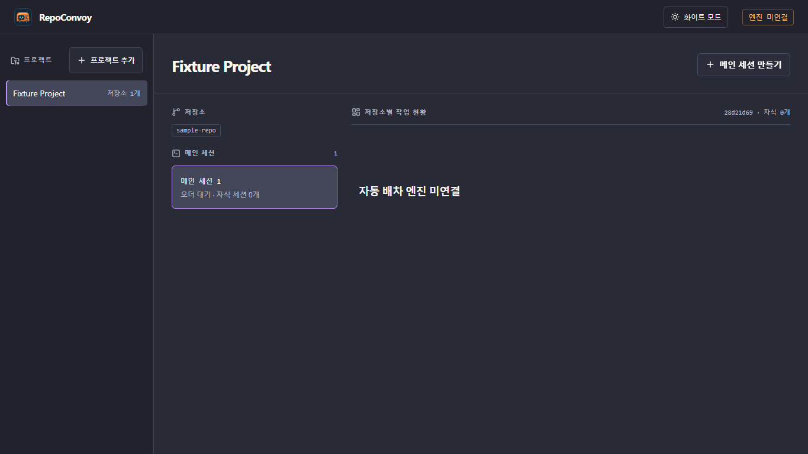
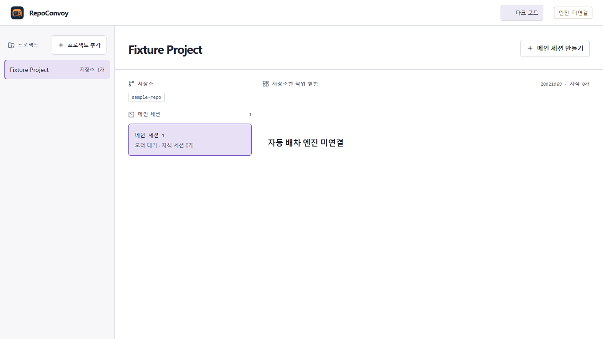

# RepoConvoy


**One order across several Git repositories; one evidence-backed human review gate.** RepoConvoy is a new Rust application for coordinating repository-bound coding agents. The owner chooses a project, sends one order, follows the real child jobs, inspects code with an AI assistant, and approves an exact candidate before a GitHub PR or GitLab MR is created.

> **Development status — not a release.** The native Rust server currently registers real local Git repositories, persists projects and parent sessions in redb, and serves the dashboard with the mascot and Dracula/white themes. The engine is explicitly **disconnected**: automatic dispatch, independent verification receipts, IDE symbol navigation, AI-directed edits, the Review PR handoff, owner approval and remote PR/MR creation are **not implemented yet**. A green test or a good-looking screenshot does not prove those flows.

## Five-minute local start

Requirements: Rust toolchain, Git, and a trusted **disposable** Git repository. From this checkout:

```sh
cargo run -- --state ./data/state.redb --port 4317
```

Open `http://127.0.0.1:4317/`, add a project using the **root directory** of your disposable Git repository, then create a parent session. The dashboard will honestly show `자동 배차 엔진 미연결`; it will not invent worker cards. The state file is local and ignored by Git. The app binds only to loopback; do not expose this unauthenticated prototype to a network or point it at confidential source.

**Windows note:** On a machine using Rust's `x86_64-pc-windows-gnullvm` toolchain, the compiled program currently needs the toolchain's `libunwind.dll` on `PATH`. If rustup was installed with `--no-modify-path`, open PowerShell in this checkout and run:

```powershell
$env:Path = "$env:USERPROFILE\.cargo\bin;$env:Path"
$env:Path = "$(rustc --print sysroot)\bin;$env:Path"
cargo run -- --state .\data\state.redb --port 4317
```

This is a development setup, **not** a packaged Windows installer. Standard MSVC builds have separate build-tool requirements.

## What is actually tested

`cargo test --all-targets` exercises real disposable Git roots, project isolation/duplicates, persisted parent sessions across a server restart, the truthful disabled capability, HTTP assets, and malformed-request errors. `cargo fmt --check` and `cargo clippy --all-targets -- -D warnings` are also required before a commit. A real headless Chrome smoke test exercised the **Rust-served** dashboard: mascot image loaded, one disposable repository registered, a parent session opened, no fake workers shown, and light-mode choice persisted after reload.

The separate UI regression test deliberately delays one project's response, switches to another project, and checks that the old response cannot overwrite its sessions or board. Run `npm ci && npx playwright install chromium && npm run test:ui` to repeat it. Node/Playwright are **test-only** dependencies; the application runtime remains Rust plus browser JavaScript.

| Dracula | White |
| --- | --- |
|  |  |

## Architecture boundary

- `src/`: Rust HTTP server, Git-root validation and durable local project/session records.
- `web/`: browser UI and local SVG icons; JavaScript is UI glue, **not the backend**.
- `assets/`: newly drawn vector mascot and app icon; the Gemini-generated reference image and its pixels are not shipped.
- `docs/PRODUCT-SCOPE.md`: end-to-end target flow and truthful acceptance milestones.
- `SECURITY.md`: limits of this unauthenticated loopback prototype.

This repository has a **fresh public history**. The earlier Node.js proof-of-concept is retained locally as a reference and is not included in this Git history. No AI provider, user repository, credential or remote account is configured by default.

## License

The project is offered under **MIT OR Apache-2.0**, at your choice (`LICENSE-MIT` and `LICENSE-APACHE`). Bundled Lucide icon paths retain their upstream notices in `THIRD_PARTY_NOTICES.md`. The new mascot is original vector artwork inspired by the owner's requested orange convoy character, not a crop of the supplied watermarked image.
